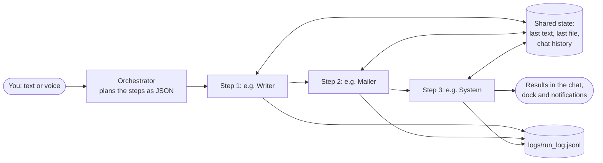

<p align="center">
  
</p>

<h1 align="center">Aura</h1>
<p align="center"><b>A multi-agent desktop assistant for Windows.</b><br>
Ask in plain English. An Orchestrator plans the steps and hands each one to a specialist agent.</p>

---

Aura writes letters and emails, sends them, reads your inbox, opens apps and websites, finds files,
plays music, sends WhatsApp messages, solves maths and code problems step by step, searches the web,
reads PDFs and pictures, sets reminders and routines, tidies folders and works with Notion — from one
chat box, by voice or by typing.

It is written in **plain Python with no agent framework**: every agent is a small, readable module, and
every safety check that matters (sending email, sending WhatsApp messages, opening apps, moving files)
is done by Python, not by an AI model.

## Contents
- [How it works](#how-it-works)
- [Agents](#agents)
- [AI models](#ai-models)
- [Requirements](#requirements)
- [Installation](#installation)
- [Configuration](#configuration)
- [Running Aura](#running-aura)
- [Using Aura](#using-aura)
- [Safety](#safety)
- [Testing](#testing)
- [Project structure](#project-structure)
- [Troubleshooting](#troubleshooting)
- [Acknowledgements](#acknowledgements)

## How it works



1. **You ask** in the chat box, the floating dock, or by voice (Whisper turns speech into text).
2. **The Orchestrator** reads the request and returns a plan: a short list of steps, each naming one agent and
   its task (at most 5 steps). Greetings and questions go to a single Chat step.
3. **Each agent runs in order.** Agents share a small state dictionary, so a later step can use an earlier
   one's result: the Writer writes an email, then the Mailer sends *that* email.
4. **Results stream to the UI** as each step finishes: a plan card, then one card per agent.
5. **Every step is logged** to `logs/run_log.jsonl` (agent, model, time, success, fallback, error).

**Example:** *"write an email to my teacher asking for an extension, then open gmail"*

```
Orchestrator -> [ {agent: writer, task: "write an email to my teacher asking for an extension"},
                  {agent: system, task: "open gmail"} ]
Writer       -> writes the email, saves outputs/extension_request_<time>.txt
System       -> opens https://mail.google.com
```

## Agents

Aura has an **Orchestrator** and **16 agents**. Any agent except the Orchestrator can be switched off from the
sidebar.

| Agent | What it does | Uses an AI model? |
|:--|:--|:--|
| **Orchestrator** | Splits the request into steps and picks an agent for each | Yes |
| **Writer** | Letters, emails, messages, notes; saves them as `.txt` in `outputs/` | Yes |
| **System** | Opens any installed app (risky ones blocked), allowlisted websites, or the last file written/found | Yes (picks the name only) |
| **Mailer** | Sends the email the Writer just wrote, through Gmail | **No** — plain Python with strict checks |
| **Inbox** | Reads, searches and summarises your Gmail (read-only) | Yes |
| **Files** | Finds files on your PC by name, type and date | Yes (plans the search) |
| **News** | Tech, finance and market news (Google News RSS) and stock prices with charts (Yahoo Finance) | Yes |
| **Calc** | Exact arithmetic and percentages | **No** |
| **WhatsApp** | Sends a message to a saved contact on WhatsApp Desktop | **No** |
| **Web** | Searches the web (Tavily) and answers with sources | Yes |
| **Reader** | Answers questions about an attached PDF, Word file, text file or image | Yes (vision model for images) |
| **Chat** | Conversation, explanations, advice, follow-ups | Yes |
| **Tutor** | Maths, physics, chemistry, biology and code, step by step with formulas (KaTeX) | Yes (reasoning model) |
| **Automate** | Reminders, routines ("every day at 8 AM…") and named workflows; phone reminders via Google Tasks/Calendar | Yes (fills a form; Python works out times) |
| **Organiser** | Tidies Downloads / Desktop / Documents into folders by type; can be undone | **No** |
| **Music** | Plays songs on Spotify or YouTube Music; pause / resume / next / previous | **No** |
| **Notion** | Searches, reads and adds notes to your Notion pages | Yes |

## AI models

Aura uses **pre-trained models through their APIs**; it does not train any model. All providers speak the
OpenAI-compatible chat API, so one function (`llm.py`) talks to all of them. Every agent has a **main model**
and a **backup on a different provider**; if both fail, a **last-resort** free model is tried.

| Used by | Main model | Backup |
|:--|:--|:--|
| Orchestrator, Writer, Chat, Web, News, Inbox, Reader, Automate, Notion | `openai/gpt-oss-120b` on **Groq** | `gemini-3.5-flash` on **Google Gemini** |
| Tutor | `openai/gpt-oss-120b` on Groq, `reasoning_effort: high` | `gemini-3.5-flash` |
| System | `qwen/qwen3.8-27b` on Groq | `gemini-3.5-flash-lite` |
| Files | `openai/gpt-oss-20b` on Groq | `gemini-3.5-flash-lite` |
| Reader (images, scanned PDFs) | `qwen/qwen3.8-27b` on Groq (vision) | none: your photos and scans are never sent to a free backup that keeps logs |
| Voice typing | `whisper-large-v3-turbo` on Groq | — |
| Every agent except image reading, if main and backup both fail | `openrouter/free` (OpenRouter's free-model router) | — |

All of this lives in **`config.py`** — the only file that names a model. Model names change often; check them
against [Groq](https://console.groq.com/docs/models), [Gemini](https://ai.google.dev/gemini-api/docs/models) and
[OpenRouter](https://openrouter.ai/models?max_price=0) if a call fails with "model not found".

## Requirements

- **Windows 10 or 11** (tested on Windows 11). The dock, voice recording, music control and WhatsApp sending use
  Windows features.
- **Python 3.10+** (developed on 3.12) — only needed to run from source or build the `.exe`.
- **Free API keys:** Groq (required), Gemini and OpenRouter (recommended backups), Tavily (for web search and Spotify).
- Optional: a Gmail account with an App Password, WhatsApp Desktop, the Spotify app, a Notion integration, a Google
  Cloud OAuth client for phone reminders.

## Installation

```bash
git clone https://github.com/ZenSensi/aura.git
cd aura
python -m venv venv
venv\Scripts\activate
pip install -r requirements.txt
copy .env.example .env
```

Open `.env` and paste your keys (see below), or start Aura and fill them in from **Settings**.

## Configuration

### API keys (`.env`)

| Key | Needed for | Get it at |
|:--|:--|:--|
| `GROQ_API_KEY` | Main model for most agents | [console.groq.com/keys](https://console.groq.com/keys) |
| `GROQ_API_KEY_SYSTEM` | Orchestrator, System, Files, Inbox, Notion (own rate limit; can be the same key) | same |
| `GEMINI_API_KEY` | Backup model | [aistudio.google.com/apikey](https://aistudio.google.com/apikey) |
| `OPENROUTER_API_KEY` | Last-resort free models | [openrouter.ai/keys](https://openrouter.ai/keys) |
| `TAVILY_API_KEY` | Web agent, Spotify song lookup | [tavily.com](https://tavily.com) (1,000 free searches/month) |
| `GMAIL_ADDRESS`, `GMAIL_APP_PASSWORD` | Mailer and Inbox | [App passwords](https://myaccount.google.com/apppasswords) (needs 2-Step Verification) |
| `USER_NAME` | Signing emails, the greeting | — |
| `NOTION_TOKEN` | Notion agent | [notion.so/profile/integrations](https://www.notion.so/profile/integrations) |

`.env` is in `.gitignore` and never leaves your PC. The Settings panel writes to it and applies changes at once;
secrets are never sent to the page, only whether each one is set.

### Optional features

<details>
<summary><b>WhatsApp contacts</b></summary>

Copy `contacts.example.json` to `contacts.json` and add names with phone numbers (with country code):

```json
{ "mahi": "+91 98765 43210" }
```

Then: *"write hello to mahi and send it on whatsapp"*. The file stays on your PC and is never sent to an AI model.
WhatsApp Desktop must be installed and signed in.
</details>

<details>
<summary><b>Phone reminders (Google Tasks + Calendar)</b></summary>

1. In [Google Cloud Console](https://console.cloud.google.com) create a project and enable the **Google Tasks API**
   and **Google Calendar API**.
2. OAuth consent screen: External, add your Gmail as a test user, then **Publish app** (in Testing mode Google signs
   you out every 7 days).
3. Credentials → Create credentials → OAuth client ID → **Desktop app** → download the JSON and save it as
   `google_client.json` in Aura's data folder (`%LOCALAPPDATA%\Aura` for the exe, see "Files" below).

The first phone reminder opens Google's sign-in page; after that the permission is kept in `google_token.json`.
Aura only asks for Tasks and Calendar, and only ever adds.
</details>

<details>
<summary><b>Notion</b></summary>

1. [notion.so/profile/integrations](https://www.notion.so/profile/integrations) → New integration → copy the
   Internal Integration Secret into Settings → Notion (`NOTION_TOKEN`).
2. In Notion, open each page Aura may use → **⋯ → Connections** → add your integration. Aura only sees shared pages.
</details>

<details>
<summary><b>Voice language</b></summary>

Set `VOICE_LANGUAGE` in `config.py` (default `"en"`; e.g. `"hi"` for Hindi).
</details>

## Running Aura

| How | Command |
|:--|:--|
| **Desktop app from source** (recommended while developing) | `python desktop.py` |
| **Build a single `Aura.exe`** | `build_exe.bat`, then double-click `Aura.exe` |
| Terminal only | `python main.py` |

The desktop app opens in its own native window (pywebview) — no browser and no web server. Keep `Aura.exe` in
the project folder, next to `.env`, `outputs\` and `logs\`.

## Using Aura

**The window**
- **Chat box** — type a request; **Enter** sends, **Shift + Enter** adds a line. The **+** button attaches a file or
  image, turns on web search, or opens the app picker. The **mic** records voice; click again to stop.
- **Welcome cards and "Try" chips** — one-click starting points (email, inbox, news, open an app, WhatsApp, web).
- **Sidebar** — New chat, **Automations** (see, run, pause or delete routines and reminders), **Recent tasks** (click
  to run again), **Agents** (click to pin one; the light switches it on/off), **Settings**, light/dark theme.
- **Dock** — minimise Aura and a glass pill appears at the top of the screen. Click it to ask without opening the
  window. Hold `` ` `` (backtick) and press **Space** in any app to open or close it. In **Settings > Dock** you can move it to any
  corner or the middle (top or bottom), pick your own shortcut, and turn on autohide (it shows only on the shortcut
  and hides 10 s after you're done).
- **Notifications** — a "task done" card slides in at the top-right when a request finishes.

**Things to try**

| Ask | What happens |
|:--|:--|
| `write a leave letter for 2 days` | Writer writes it and saves it in `outputs/` |
| `write an email to friend@gmail.com wishing her luck, then send it` | Writer → Mailer |
| `summarise my 5 latest unread emails` | Inbox reads Gmail (read-only) |
| `open vs code` / `open youtube` | System opens the app or site |
| `find my resume pdf and open it` | Files finds it, System opens it |
| `today's tech and stock market news` | News with market charts |
| `what is 18% of 2450?` | Calc: 441, exact |
| `solve x^2 + 5x + 6 = 0` | Tutor, step by step |
| `who won the cricket world cup` | Web search with sources |
| `play kesariya on spotify` | Music plays it in the Spotify app |
| `send "running late" to mahi on whatsapp` | WhatsApp sends to your saved contact |
| `remind me in 20 minutes to drink water` | Automate sets a reminder |
| `every day at 8 AM give me today's tech news` | Automate creates a routine |
| `organise my downloads folder` | Organiser sorts files into folders (undo available) |
| *attach a PDF* + `summarise this` | Reader |
| `add "buy milk" to my Notion shopping page` | Notion |

## Safety

Actions that can't be undone are guarded by **Python, not by the model**:

- **Email:** sends only to addresses **you typed**, only the email written in the same request, refuses drafts with
  blanks like `[Your Name]`, max 3 recipients. The Inbox is opened read-only and never marks mail as read.
- **WhatsApp:** sends only to a contact you named, from your own `contacts.json`, and presses Enter only if the
  WhatsApp window is in front.
- **Apps:** the model only picks a name; Python looks up the real command. Apps that can run commands or change the
  system (PowerShell, Command Prompt, Registry Editor, Control Panel, …) are always blocked.
- **Files:** the Organiser only moves (never deletes) and records every move so it can be undone.
- **Automations:** routines run through the normal Orchestrator with all its checks, at most every 15 minutes, and
  can't create more automations.
- **Untrusted text:** the Inbox, Reader, News, Notion and Writer agents tell the model to treat email, file, page and
  headline text as data and to ignore any instructions inside it.

## Testing

```bash
python run_tests.py
```

Runs the labelled requests in `run_tests.py` (33 at present) in **dry-run mode** (nothing is opened or sent) and checks that the Orchestrator chose the
expected agents in the expected order. Prints a pass/fail table and saves `logs/test_results.csv`.

## Project structure

```
aura/
├── desktop.py            # Desktop app: native window (pywebview) + API the page calls
├── dock.py               # Floating glass dock shown while Aura is minimised
├── hotkey.py             # The dock's keyboard shortcut (works in every app)
├── notify.py             # "Task done" notifications
├── orchestrator.py       # Plans steps (JSON) and runs them with shared state
├── llm.py                # One function for every OpenAI-compatible API + fallbacks + JSON parsing
├── config.py             # Models, providers, limits, allowlists — the only file naming a model
├── logger.py             # Writes every step to logs/run_log.jsonl
├── automations.py        # Stores automations and runs the scheduler clock
├── google_sync.py        # Phone reminders via Google Tasks + Calendar
├── nowplaying.py         # Reads Windows media sessions (what is playing)
├── voice.py              # Records the mic and transcribes with Whisper
├── agents/               # One file per agent (writer, system, mailer, inbox, files, news, calc,
│                         #   whatsapp, web, reader, chat, tutor, automate, organiser, music, notion)
├── static/               # The UI: index.html, style.css, app.js, dock, notifications, vendor libs
├── assets/               # Logo and icons (make_logo.py draws them)
├── run_tests.py          # Labelled test requests (dry run)
├── main.py               # Terminal version
├── build_exe.bat         # Builds Aura.exe with PyInstaller
├── .env.example          # Template for your API keys
└── contacts.example.json # Template for WhatsApp contacts
```

Files Aura creates while running (not in the repository): `.env`, `contacts.json`, `google_client.json`,
`google_token.json`, `automations.json`, `agents_off.json`, `outputs/`, `logs/run_log.jsonl`.
They live in the project folder when run with Python. `Aura.exe` keeps them in `%LOCALAPPDATA%\Aura` (one set per
Windows user, so the exe can be shared or installed anywhere), unless a `.env` sits next to the exe ("portable" mode).

## Troubleshooting

| Problem | Fix |
|:--|:--|
| `API error 429` / "rate limit" | Free-tier limit reached. Aura retries on the backup model automatically; add `GEMINI_API_KEY` and `OPENROUTER_API_KEY` so backups exist, or wait a minute. |
| "model not found" | The provider renamed or retired a model. Update the name in `config.py`. |
| Web search says it needs a key | Add `TAVILY_API_KEY` in Settings. |
| Email won't send | Use a Gmail **App Password**, not your normal password, and check `GMAIL_ADDRESS`. |
| WhatsApp message typed but not sent | Another window took focus; Aura stops instead of pressing Enter in the wrong place. Send it yourself or try again. |
| Voice types the wrong language | Set `VOICE_LANGUAGE` in `config.py`. |
| Changes to code don't show in `Aura.exe` | Rebuild with `build_exe.bat`. |

## Acknowledgements

- Models served by [Groq](https://groq.com), [Google Gemini](https://ai.google.dev) and [OpenRouter](https://openrouter.ai);
  web search by [Tavily](https://tavily.com).
- UI libraries: [pywebview](https://pywebview.flowrl.com), [marked](https://marked.js.org),
  [DOMPurify](https://github.com/cure53/DOMPurify), [KaTeX](https://katex.org).
